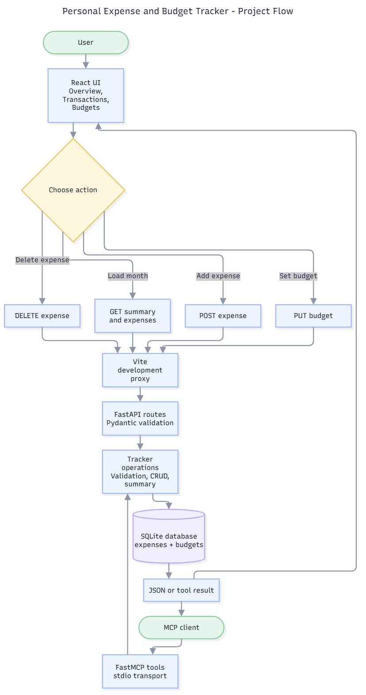

# Personal Expense and Budget Tracker

A local expense and budget tracker with a React frontend, a FastAPI backend,
and a standalone FastMCP 2.x server. Both Python servers use the same SQLite
database. The web app displays amounts in Indian rupees (INR).

## Project flow



## Set up with UV

Prerequisites: [UV](https://docs.astral.sh/uv/getting-started/installation/)
and Python 3.12 or newer. In PowerShell, from the project directory:

```powershell
uv sync
uv run python -m unittest discover -s tests -v
```

`uv sync` creates and manages `.venv` and installs the dependencies recorded in
`uv.lock`. This project was initialized with `uv init .`. To add FastMCP 2.x
to a project, use `uv add "fastmcp>=2,<3"`. You do not need to activate the environment
when using `uv run`. To add another dependency later, use `uv add package-name`.
Keep `pyproject.toml` and `uv.lock` in version control, but not `.venv`.

## Web application

The React frontend lives in `frontend/` and talks only to the FastAPI HTTP
endpoints. FastAPI and the MCP server use the same local SQLite database. Request
bodies are validated with Pydantic before the existing tracker operations run.
Node.js 20.19+ or 22.12+ is required for the frontend.

Run the API from the project directory:

```powershell
uv sync
uv run uvicorn api:app --host 127.0.0.1 --port 8000
```

In a second terminal, start the frontend:

```powershell
npm --prefix frontend install
npm --prefix frontend run dev
```

Open the URL printed by Vite (normally `http://localhost:5173`). During
development Vite forwards `/api` requests to `http://127.0.0.1:8000`.
The API documentation is available at `http://127.0.0.1:8000/docs`. This is a
local app without authentication; do not expose the API publicly.

## FastAPI endpoints

Base URL: `http://127.0.0.1:8000`. There are **five application API operations**:

| Method | Path | Purpose | Request body |
| --- | --- | --- | --- |
| `GET` | `/api/expenses` | List expenses, with optional filters | None |
| `POST` | `/api/expenses` | Add an expense | JSON expense |
| `DELETE` | `/api/expenses/{expense_id}` | Delete an expense by ID | None |
| `PUT` | `/api/budgets` | Create or replace a monthly category budget | JSON budget |
| `GET` | `/api/summary` | Get a monthly spending and budget summary | None |

The examples below use November 2026 and assume an initially empty database.
IDs are generated by SQLite, so use the ID returned by your own `POST` request.
Amounts are **JSON strings**, not numbers, and must be positive with at most two
decimal places. Dates use `YYYY-MM-DD`; months use `YYYY-MM`. Categories cannot
be blank and are trimmed and normalized using Unicode case folding. Descriptions
are trimmed. All stored amounts are treated as the same currency; the API does
not convert currencies.

### 1. Add an expense

`POST /api/expenses`

```json
{
	"amount": "150.50",
	"category": "Food",
	"expense_date": "2026-11-18",
	"description": "Lunch"
}
```

`amount` and `category` are required. `expense_date` and `description` are
optional; an omitted or empty date uses today's date, and an omitted description
is empty. A successful response has status `201 Created`:

```json
{
	"id": 1,
	"date": "2026-11-18",
	"category": "food",
	"amount": "150.50",
	"description": "Lunch"
}
```

### 2. List expenses

`GET /api/expenses?month=2026-11&category=food`

Both query parameters are optional. `month` filters by month and `category`
filters by category, ignoring case. Omit both to list all expenses. An empty
result is `[]`. For the example expense, the response is `200 OK`:

```json
[
	{
		"id": 1,
		"date": "2026-11-18",
		"category": "food",
		"amount": "150.50",
		"description": "Lunch"
	}
]
```

### 3. Delete an expense

`DELETE /api/expenses/1`

Replace `1` with an existing expense ID. This permanently deletes the expense.
The successful response is `200 OK`:

```json
{
	"id": 1,
	"deleted": true
}
```

An unknown ID returns `404 Not Found` with `{"detail": "Expense not found."}`.

### 4. Set a category budget

`PUT /api/budgets`

```json
{
	"month": "2026-11",
	"category": "Food",
	"amount": "1000.00"
}
```

All three fields are required. Setting the same month and category again
replaces its previous budget. The response is `200 OK`:

```json
{
	"month": "2026-11",
	"category": "food",
	"amount": "1000.00"
}
```

### 5. Get a monthly summary

`GET /api/summary?month=2026-11`

The `month` query parameter is required. After creating the example expense
and budget above, and before deleting the expense, the response is `200 OK`:

```json
{
	"month": "2026-11",
	"total_spent": "150.50",
	"categories": [
		{
			"category": "food",
			"spent": "150.50",
			"budget": "1000.00",
			"remaining": "849.50",
			"over_budget": false
		}
	]
}
```

Categories without a budget have `null` for `budget` and `remaining`. A negative
`remaining` amount means spending exceeded the category budget.

### Validation and errors

- `400 Bad Request`: invalid query values, such as a month outside `YYYY-MM`.
- `422 Unprocessable Entity`: a missing required field, invalid request body,
	invalid path parameter, or missing required query parameter. Pydantic errors
	include a `detail` list identifying the problematic field.
- `404 Not Found`: the expense ID supplied to `DELETE` does not exist.

### Try the API in Postman

1. Start the API with `uv run uvicorn api:app --host 127.0.0.1 --port 8000`.
2. Open Postman and create a new HTTP request. Set the method and URL from the
	 endpoint examples above, using `http://127.0.0.1:8000` as the base URL.
3. For `POST /api/expenses` and `PUT /api/budgets`, select **Body > raw > JSON**,
	 paste the matching JSON example, and send it. Postman should set
	 `Content-Type: application/json`; add that header if it does not.
4. For `GET` requests, use the **Params** tab to add `month` and, for listing
	 expenses, optionally `category`. `DELETE` uses an ID in the URL and no body.
5. Select **Send** and inspect the response status and JSON body. Try the budget,
	 add, list, and summary requests before deleting the expense.

Postman requests change the same database used by the web app and MCP server.
To experiment without touching existing records, stop the API and start it in a
PowerShell session with a separate database path:

```powershell
$env:EXPENSE_TRACKER_DB = "$env:TEMP\expense-tracker-postman.db"
uv run uvicorn api:app --host 127.0.0.1 --port 8000
```

## MCP server

To start the server directly, run `uv run python main.py`. It communicates over
standard input/output and waits for an MCP client, so it is not a web page.
Stop it with Ctrl+C. Normally, configure the client to start it for you instead.

## Connect in VS Code

Create `.vscode/mcp.json` in this project with the configuration below. Change
the directory if the project moves, and make sure `uv` is on VS Code's PATH.

```json
{
	"servers": {
		"expense-tracker": {
			"type": "stdio",
			"command": "uv",
			"args": [
				"--directory",
				"C:\\Users\\Sunny\\MCP_Projects\\Personal_expense_and_budget_tracker",
				"run",
				"python",
				"main.py"
			]
		}
	}
}
```

Start the server from VS Code's MCP server controls and enable its tools in your
MCP-capable chat. For example, ask: "Set my food budget for November 2026 to
200.00, record a 12.50 food expense on 2026-11-17, and show my monthly summary."
Review tool calls before allowing changes or deletion.

## Available tools

- `add_expense(amount, category, expense_date, description)` records an expense.
	`amount` is a string such as `"12.50"`; the date defaults to today.
- `list_expenses(month, category)` lists expenses, optionally filtered by month
	(`YYYY-MM`) and/or category.
- `delete_expense(expense_id)` removes an expense by ID and reports whether it existed.
- `set_budget(month, category, amount)` creates or replaces a monthly category budget.
- `monthly_summary(month)` shows total spending, category budgets, remaining
	amounts, and whether a category is over budget. Negative remaining means overspent.

Dates use `YYYY-MM-DD`; months use `YYYY-MM`. Amounts must be positive with at
most two decimal places. Categories are trimmed and normalized to lowercase
using Unicode case folding. The web app displays amounts as Indian rupees (INR).
Existing values are not converted; the server does not convert or track currencies.

## Storage and design

By default, the database is stored at `~/.expense-tracker/expenses.db`. Set
`EXPENSE_TRACKER_DB` to an absolute file path in the MCP server configuration's
`env` object to use a different location. The server creates the directory and
tables as needed. Back up this file to preserve your records; it is not encrypted.
Only connect trusted MCP clients: they can read, add, and delete your financial data.

SQLite needs no separate database service and persists data across server runs.
Amounts are converted from decimal strings to integer cents so calculations do
not have floating-point rounding errors. FastMCP exposes the Python functions
as discoverable MCP tools. The direct dependency is restricted to FastMCP 2.x;
its required MCP protocol SDK is installed automatically as a dependency.
Tests use a temporary database and include a real stdio MCP client/server round trip.
