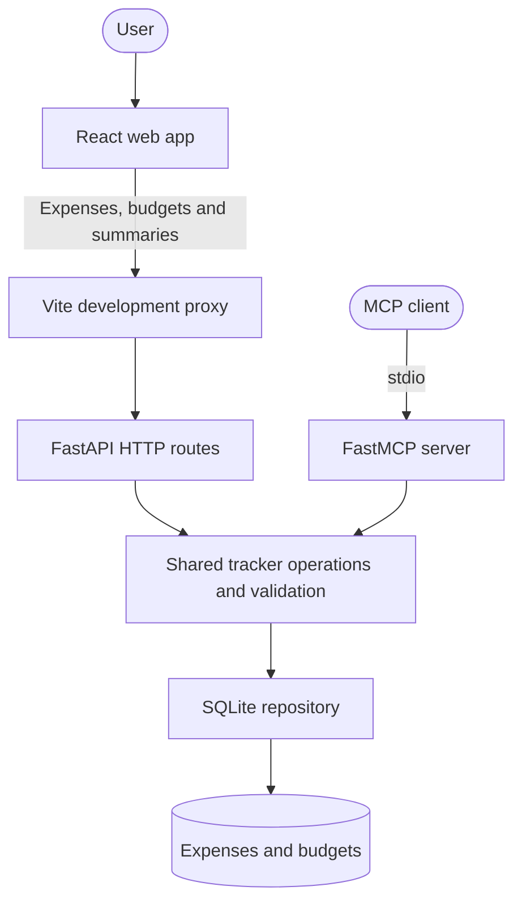

# Architecture

Expense & Budget Tracker runs locally. The web application and MCP server are
separate processes that share the same Python operations and SQLite database.



In development, Vite forwards `/api` requests to FastAPI. The MCP client starts
the MCP server separately; it does not need the HTTP server. Both processes
must use the same `EXPENSE_TRACKER_DB` value to share a non-default database.

## Project layout

```text
tracker/
  core/          Shared validation and expense/budget operations
  storage/       SQLite connection, table initialization and queries
  api/           FastAPI application and request models
  mcp_server/    MCP tool registration and stdio entry point
frontend/
  src/
    api/         HTTP request helper
    components/  Dialog, tables, budget list and monthly trends
    pages/       Overview, transactions and budgets
    utils/       Date and display formatting
  tests/         Frontend trend tests
tests/
  api_tests/     API integration tests
  core/          Shared operation tests
  mcp_tests/     MCP stdio integration tests
```

`api.py` and `main.py` remain compatibility entry points. For new
configurations, use `tracker.api.app:app` for FastAPI and
`python -m tracker.mcp_server.server` for MCP. See the [README](../README.md)
for complete commands.

## Data flow

- The web app adds, edits, lists, and deletes expenses through FastAPI. Editing
  replaces the amount, category, date, and description; changing the date can
  move an expense into a different month.
- The overview requests monthly summaries for the selected month and five
  preceding months. It displays each month's total spending, including zero for
  months without expenses.
- MCP exposes `add_expense`, `list_expenses`, `delete_expense`, `set_budget`,
  and `monthly_summary`. Expense editing is currently available through the
  web app and HTTP API, not as an MCP tool.
- The repository stores money as integer cents in SQLite. The default database
  path remains `~/.expense-tracker/expenses.db`; `EXPENSE_TRACKER_DB` overrides it.

The [original flow chart](assets/project-flow.png) is retained for reference;
it predates expense editing and the current package structure.
