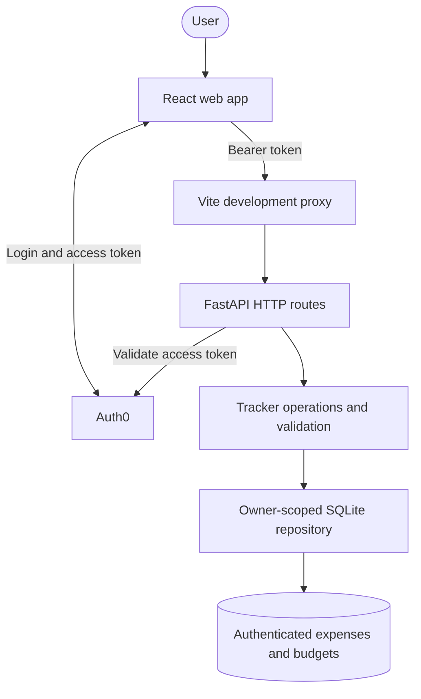

# Architecture

The local React application signs users in with Auth0. FastAPI validates access
tokens and scopes before running operations against an owner-scoped SQLite
database. The former anonymous MCP server is disabled until authenticated MCP
support is implemented.

In development, Vite forwards `/api` requests to FastAPI. The API validates
the Auth0 issuer, audience, signature, time claims, subject and required scopes.
The owner is derived from the verified issuer and subject, never request input.

## Project layout

- `tracker/core/`: validation and expense/budget operations.
- `tracker/storage/`: authenticated SQLite schema and owner-scoped queries.
- `tracker/api/`: FastAPI routes and Auth0 access-token validation.
- `tracker/mcp_server/`: disabled MCP entry point.
- `frontend/src/`: React authentication, pages, components and API requests.
- `tests/`: API authentication, isolation, tracker and disabled-MCP tests.

The authenticated database defaults to `~/.expense-tracker/authenticated.db`;
`EXPENSE_TRACKER_DB` overrides it. The original unowned
`~/.expense-tracker/expenses.db` remains separate. Legacy schemas are rejected,
not silently migrated.

The [original flow chart](assets/project-flow.png) is retained for historical
reference and predates these changes. See the [README](../README.md) for setup.
